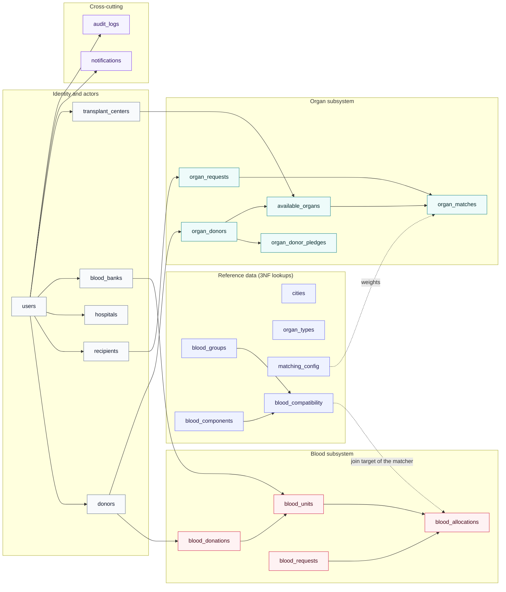

# Entity–Relationship Diagram

Database: **`blood_organ_network`** · 23 tables · 50 foreign keys · 11 CHECK constraints

Every relationship below was verified against `information_schema` on the live
database, so this diagram and `backend/sql/schema.sql` cannot contradict each other.

---

## 1. Full ER diagram

```mermaid
erDiagram
    CITIES ||--o{ DONORS : "located in"
    CITIES ||--o{ RECIPIENTS : "located in"
    CITIES ||--o{ HOSPITALS : "located in"
    CITIES ||--o{ BLOOD_BANKS : "located in"
    CITIES ||--o{ AVAILABLE_ORGANS : "held in"

    BLOOD_GROUPS ||--o{ DONORS : "has"
    BLOOD_GROUPS ||--o{ RECIPIENTS : "has"
    BLOOD_GROUPS ||--o{ BLOOD_UNITS : "typed as"
    BLOOD_GROUPS ||--o{ BLOOD_DONATIONS : "typed as"
    BLOOD_GROUPS ||--o{ BLOOD_REQUESTS : "requests"
    BLOOD_GROUPS ||--o{ AVAILABLE_ORGANS : "typed as"
    BLOOD_GROUPS ||--o{ ORGAN_REQUESTS : "requests"
    BLOOD_GROUPS ||--o{ BLOOD_COMPATIBILITY : "as donor"
    BLOOD_GROUPS ||--o{ BLOOD_COMPATIBILITY : "as recipient"
    BLOOD_COMPONENTS ||--o{ BLOOD_COMPATIBILITY : "rule for"
    BLOOD_COMPONENTS ||--o{ BLOOD_UNITS : "separated into"
    BLOOD_COMPONENTS ||--o{ BLOOD_REQUESTS : "requests"

    USERS ||--o| DONORS : "is a"
    USERS ||--o| RECIPIENTS : "is a"
    USERS ||--o| HOSPITALS : "administers"
    USERS ||--o| BLOOD_BANKS : "administers"
    USERS ||--o| TRANSPLANT_CENTERS : "administers"
    USERS ||--o{ NOTIFICATIONS : "receives"
    USERS ||--o{ AUDIT_LOGS : "performs"

    HOSPITALS ||--o| TRANSPLANT_CENTERS : "hosts"
    HOSPITALS ||--o{ BLOOD_BANKS : "may operate"
    HOSPITALS ||--o{ BLOOD_REQUESTS : "raises"
    HOSPITALS ||--o{ ORGAN_REQUESTS : "raises"

    DONORS ||--o{ BLOOD_DONATIONS : "gives"
    BLOOD_BANKS ||--o{ BLOOD_DONATIONS : "collects"
    BLOOD_BANKS ||--o{ BLOOD_UNITS : "stores"
    BLOOD_DONATIONS ||--o{ BLOOD_UNITS : "separated into"

    RECIPIENTS ||--o{ BLOOD_REQUESTS : "raises"
    BLOOD_REQUESTS ||--o{ BLOOD_ALLOCATIONS : "fulfilled by"
    BLOOD_UNITS ||--o{ BLOOD_ALLOCATIONS : "allocated via"

    DONORS ||--o| ORGAN_DONORS : "registers as"
    ORGAN_DONORS ||--o{ ORGAN_DONOR_PLEDGES : "pledges"
    ORGAN_TYPES ||--o{ ORGAN_DONOR_PLEDGES : "pledged as"
    ORGAN_DONORS ||--o{ AVAILABLE_ORGANS : "yields"
    ORGAN_TYPES ||--o{ AVAILABLE_ORGANS : "classifies"
    ORGAN_TYPES ||--o{ ORGAN_REQUESTS : "classifies"
    TRANSPLANT_CENTERS ||--o{ AVAILABLE_ORGANS : "holds"

    RECIPIENTS ||--o{ ORGAN_REQUESTS : "raises"
    ORGAN_REQUESTS ||--o{ ORGAN_MATCHES : "scored into"
    AVAILABLE_ORGANS ||--o{ ORGAN_MATCHES : "candidate in"

    CITIES {
        int city_id PK
        varchar name UK "UNIQUE(name,state)"
        varchar state
        varchar region
    }
    BLOOD_GROUPS {
        tinyint blood_group_id PK
        varchar group_code UK "A+, O-, ..."
        enum abo_type
        enum rh_factor
        boolean has_a "antigen flags drive the"
        boolean has_b "compatibility matrix"
        boolean has_rh_d
        decimal population_pct
    }
    BLOOD_COMPONENTS {
        tinyint component_id PK
        varchar code UK
        varchar name
        smallint shelf_life_days "derives unit expiry"
        varchar storage_temp
        enum match_direction "CELLULAR | PLASMA"
    }
    BLOOD_COMPATIBILITY {
        tinyint donor_group_id PK,FK
        tinyint recipient_group_id PK,FK
        tinyint component_id PK,FK
        boolean is_compatible
        varchar rule_note
    }
    ORGAN_TYPES {
        tinyint organ_type_id PK
        varchar code UK
        varchar name
        smallint max_cold_ischemia_hours "derives viability deadline"
        boolean living_donation_possible
        tinyint min_donor_age
        tinyint max_donor_age
    }
    MATCHING_CONFIG {
        varchar config_key PK
        decimal config_value "organ match weights"
        varchar description
    }
    USERS {
        int user_id PK
        varchar full_name
        varchar email UK
        varchar password_hash "bcrypt, never returned"
        varchar phone
        enum role "6 roles"
        enum status
        datetime last_login_at
    }
    DONORS {
        int donor_id PK
        int user_id FK,UK "1:1 with users"
        date date_of_birth
        enum gender
        tinyint blood_group_id FK
        int city_id FK
        decimal weight_kg
        date last_donation_date
        int total_donations "maintained by trigger"
        enum eligibility_status
    }
    RECIPIENTS {
        int recipient_id PK
        int user_id FK,UK
        date date_of_birth
        enum gender
        tinyint blood_group_id FK
        int city_id FK
        text medical_notes
    }
    HOSPITALS {
        int hospital_id PK
        int user_id FK,UK "nullable"
        varchar name
        varchar registration_number UK
        int city_id FK
        varchar email UK
        smallint bed_capacity
        enum status
    }
    BLOOD_BANKS {
        int blood_bank_id PK
        int user_id FK,UK "nullable"
        int hospital_id FK "nullable"
        varchar name
        varchar registration_number UK
        int city_id FK
        enum status
    }
    TRANSPLANT_CENTERS {
        int center_id PK
        int hospital_id FK,UK "1:1 with hospital"
        int user_id FK,UK
        varchar license_number UK
        enum status
    }
    BLOOD_DONATIONS {
        int donation_id PK
        int donor_id FK
        int blood_bank_id FK
        tinyint blood_group_id FK
        date donation_date
        smallint volume_ml
        decimal hemoglobin_gdl
        enum screening_status "PENDING|PASSED|FAILED"
        int recorded_by FK
    }
    BLOOD_UNITS {
        int blood_unit_id PK
        varchar unit_code UK
        int donation_id FK "nullable"
        int blood_bank_id FK
        tinyint blood_group_id FK
        tinyint component_id FK
        smallint volume_ml
        date collection_date
        date expiry_date "derived by trigger"
        enum status "7-state lifecycle"
    }
    BLOOD_REQUESTS {
        int blood_request_id PK
        varchar request_code UK
        int recipient_id FK "nullable"
        int hospital_id FK
        tinyint blood_group_id FK
        tinyint component_id FK
        smallint units_required
        smallint units_allocated
        enum urgency
        date required_by
        enum status "8-state workflow"
        int created_by FK
    }
    BLOOD_ALLOCATIONS {
        int allocation_id PK
        int blood_request_id FK "UNIQUE(request,unit)"
        int blood_unit_id FK
        int allocated_by FK
        datetime allocated_at
        enum status
    }
    ORGAN_DONORS {
        int organ_donor_id PK
        int donor_id FK,UK "1:1 with donors"
        date registration_date
        enum donor_kind "LIVING|DECEASED"
        enum consent_status
        enum medical_status
        varchar next_of_kin
    }
    ORGAN_DONOR_PLEDGES {
        int pledge_id PK
        int organ_donor_id FK "UNIQUE(donor,type)"
        tinyint organ_type_id FK
        date pledged_at
        enum status
    }
    AVAILABLE_ORGANS {
        int organ_id PK
        varchar organ_code UK
        int organ_donor_id FK
        tinyint organ_type_id FK
        tinyint blood_group_id FK
        int center_id FK
        int city_id FK
        tinyint donor_age
        varchar hla_type
        enum medical_status
        enum availability_status
        datetime recovered_at
        datetime viable_until "derived by trigger"
    }
    ORGAN_REQUESTS {
        int organ_request_id PK
        varchar request_code UK
        int recipient_id FK
        int hospital_id FK
        tinyint organ_type_id FK
        tinyint blood_group_id FK
        enum urgency
        tinyint medical_priority "0-100"
        tinyint recipient_age
        enum status "8-state workflow"
        int created_by FK
    }
    ORGAN_MATCHES {
        int match_id PK
        int organ_request_id FK "UNIQUE(request,organ)"
        int organ_id FK
        decimal compatibility_score "weighted total"
        decimal blood_score
        decimal urgency_score
        decimal priority_score
        decimal location_score
        decimal age_score
        varchar match_reason
        enum status
        int decided_by FK
    }
    NOTIFICATIONS {
        int notification_id PK
        int user_id FK
        varchar title
        varchar message
        enum type
        varchar entity_name
        int entity_id
        boolean is_read
    }
    AUDIT_LOGS {
        bigint audit_id PK
        int user_id FK "NULL when written by a trigger"
        varchar action
        varchar entity_name
        int entity_id
        varchar description
        enum source "API|TRIGGER|PROCEDURE"
        varchar ip_address
    }
```



---

## 2. Relationship inventory

### One-to-one (enforced by a UNIQUE constraint on the foreign key)

| Parent | Child | FK column | Why 1:1 |
|---|---|---|---|
| `users` | `donors` | `user_id` UNIQUE | One login = at most one donor profile |
| `users` | `recipients` | `user_id` UNIQUE | One login = at most one patient profile |
| `users` | `hospitals` | `user_id` UNIQUE | One login administers one hospital |
| `users` | `blood_banks` | `user_id` UNIQUE | One login administers one bank |
| `users` | `transplant_centers` | `user_id` UNIQUE | One login administers one centre |
| `donors` | `organ_donors` | `donor_id` UNIQUE | A donor registers as an organ donor at most once |
| `hospitals` | `transplant_centers` | `hospital_id` UNIQUE | A centre operates inside exactly one hospital |

The UNIQUE constraint is what makes these 1:1 rather than 1:N — without it the
schema would silently permit two donor profiles per login.

### One-to-many (selected)

| Parent | Child | Meaning |
|---|---|---|
| `donors` | `blood_donations` | A donor gives many donations over time |
| `blood_donations` | `blood_units` | One donation separates into several component units |
| `blood_banks` | `blood_units` | A bank stores many units |
| `hospitals` | `blood_requests` | A hospital raises many requests |
| `organ_donors` | `available_organs` | One donor can yield several organs |
| `transplant_centers` | `available_organs` | A centre holds many organs |
| `cities` | `hospitals`, `blood_banks`, `donors`, `recipients`, `available_organs` | Location reference |

### Many-to-many (resolved by associative tables)

| Relationship | Associative table | Key |
|---|---|---|
| Blood groups ↔ blood groups, per component | `blood_compatibility` | `(donor_group_id, recipient_group_id, component_id)` |
| Requests ↔ physical units | `blood_allocations` | `(blood_request_id, blood_unit_id)` UNIQUE |
| Organ donors ↔ organ types | `organ_donor_pledges` | `(organ_donor_id, organ_type_id)` UNIQUE |
| Organ requests ↔ available organs | `organ_matches` | `(organ_request_id, organ_id)` UNIQUE |

`blood_compatibility` is a **ternary** relationship: compatibility is not a
property of a pair of blood groups alone, because plasma reverses the ABO rule.
The component therefore belongs in the primary key.

---

## 3. Referential-integrity policy

The delete rule on each foreign key is a deliberate statement about whether the
child row can exist without its parent.

| Rule | Used for | Rationale |
|---|---|---|
| `CASCADE` | `users → donors/recipients`, `users → notifications`, `organ_donors → pledges`, `blood_requests → blood_allocations`, `organ_requests/available_organs → organ_matches` | The child is existentially dependent: a donor profile is meaningless without its user, a pledge without its donor |
| `RESTRICT` | `donors → blood_donations`, `blood_units → blood_allocations`, all lookup tables | The child is a permanent medical or historical record. Deleting a donor who has donated is refused by the database — and this is the correct behaviour, surfaced by the API as *"Medical history cannot be deleted; suspend the account instead."* |
| `SET NULL` | `users → hospitals/blood_banks/transplant_centers`, `*.created_by`, `*.recorded_by`, `blood_donations → blood_units` | The reference is informational. Removing the staff member who recorded a donation must not delete the donation |

No foreign key uses `CASCADE` toward a clinical record. That is the single most
important integrity decision in this schema.

---

## 4. Subsystem view



---

## 5. Verifying the diagram against the database

```bash
mysql -u root -p blood_organ_network -e "
SELECT CONCAT(referenced_table_name,' 1--N ',table_name,' (',column_name,')') AS relationship
FROM information_schema.key_column_usage
WHERE table_schema='blood_organ_network' AND referenced_table_name IS NOT NULL
ORDER BY referenced_table_name, table_name;"
```

This returns the 50 foreign keys drawn above.
